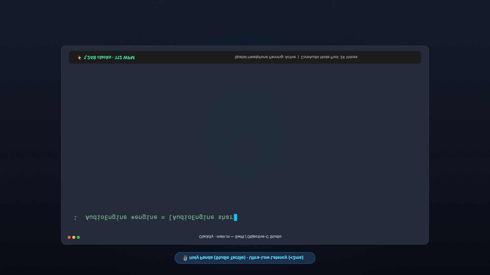

# Clackity ⌨️✨

[-00d2ff?style=for-the-badge&logo=apple&logoColor=white)](https://github.com/jojoyboy/Clackityclack/releases/latest/download/Clackity-Installer.pkg)
[](https://github.com/jojoyboy/Clackityclack/releases)
[](https://github.com/jojoyboy/Clackityclack)
[](LICENSE)

A high-performance, bloat-free native macOS menu bar companion that brings acoustic feedback and fluid tactile feel to every keystroke and mouse click across your entire Mac. 

Engineered with 100% native Cocoa, CoreAudio, and Metal — with **zero Electron bloat**, **zero web runtimes**, **zero telemetry**, and an ultra-lean **<2.5 MB RAM footprint**.

<div align="center">
  <a href="https://raw.githubusercontent.com/jojoyboy/Clackityclack/main/assets/clackity-demo.mp4">
    
  </a>
  <p>
    <em>🎬 <strong><a href="https://raw.githubusercontent.com/jojoyboy/Clackityclack/main/assets/clackity-demo.mp4">Click to watch 1080p Product Showcase Demo (with audio)</a></strong> · Featuring Holy Panda, NovelKeys Cream, IBM Model M, and Hemingway Typewriter Margin Bell & Carriage Return.</em>
  </p>
</div>

---

## 📦 Download & Installation

### Option 1: Install via Homebrew (Recommended — Seamless & Gatekeeper-Free)

The fastest and cleanest way to install and manage Clackity on macOS:

```bash
brew tap jojoyboy/clackity
brew install --cask clackity
```
*(Or in a single command: `brew install --cask jojoyboy/clackity/clackity`)*

Homebrew handles installation, quarantine flags, and permissions automatically! To update anytime:
```bash
brew upgrade --cask clackity
```

---

### Option 2: Download Installer (.pkg) or Standalone App (.zip)

1. **[Download Clackity-Installer.pkg](https://github.com/jojoyboy/Clackityclack/releases/latest/download/Clackity-Installer.pkg)** *(or grab the portable `.zip` from [Releases](https://github.com/jojoyboy/Clackityclack/releases))*.
2. Double-click the downloaded `.pkg` file to install Clackity into your `/Applications` folder.
3. Launch **Clackity** from Applications or Spotlight.
4. Click the Keycap icon in your menu bar and grant Accessibility permission when prompted. Enjoy!

> **Architecture Support**: Built as a **Universal 2 Binary** (`arm64` + `x86_64`). Runs natively at full speed on all Apple Silicon Macs (M1/M2/M3/M4) and Intel-based Macs running macOS 13.0+.

---

## 🛡️ macOS Gatekeeper: Opening Open-Source Apps

Because Clackity is a free, community-driven open-source project distributed outside the Apple Mac App Store without a paid ($99/yr) Apple Developer certificate, macOS Gatekeeper flags internet-downloaded files with a security quarantine alert (*"Apple cannot verify that Clackity is free of malware"* or *"Move to Trash"*).

To open the app or installer smoothly, use either method below:

### Method 1: The Quick One-Line Terminal Fix (Fastest)
Open **Terminal** and run:
```bash
# If installed via .pkg or dragged to Applications:
xattr -cr /Applications/Clackity.app

# Or if macOS blocks the .pkg installer itself:
xattr -d com.apple.quarantine ~/Downloads/Clackity-Installer.pkg
```
This simply removes the quarantine download flag attached by your browser. Clackity will open instantly without warnings!

### Method 2: System Settings (No Terminal Needed)
1. Double-click **Clackity** (or `Clackity-Installer.pkg`). If prompted with a warning dialog, click **Done** or **Cancel**.
2. Open **System Settings** on your Mac.
3. Navigate to **Privacy & Security** and scroll down to the **Security** section.
4. You will see: *"Clackity was blocked from use because it is not from an identified developer"*.
5. Click **"Open Anyway"** and enter your Mac password or Touch ID when prompted.
6. Alternatively: In Finder, **Right-click** (or **Control-click**) the file, select **Open**, and then click **Open** on the confirmation dialog.

---

## ⚡ Highlights & Key Features

### 🪟 Apple Liquid Glass Interface (`⌘,`)
- **Native Frosted Aesthetics**: Translucent frosted glass backing, specular border rims (`0.5pt`), smooth `12pt` squircle cards, and generous padding following Apple Human Interface Guidelines.
- **Dedicated Sidebar Navigation**:
  - 🎧 **Switches**: Select and audition authentic hardware recordings and high-precision physical synthesizers with one-click preview playback.
  - 🎛️ **Acoustics & EQ**: 3-band parametric acoustic EQ (Thock/Clack balance tilt shelf), dynamic strike velocity (`WPM` and typing force dynamics), Force-Click audio feedback, and spatial stereo headphone panning.
  - ✨ **Click Effects**: GPU-accelerated cursor click shockwaves with customizable aesthetic color themes.
  - 📦 **Sound Store**: In-app mechanical sound pack browser with audio previews and instant 1-click installation.
  - ⚙️ **General**: Launch at login (`SMAppService`), background auto-updates, and live typing odometer.
- **Pure Menu Bar Operation**: Closing the Settings window via the red cross (`X`) cleanly dismisses the window while keeping Clackity running purely in the status menu bar (`LSUIElement = true`) with **zero Dock clutter**.

### 🔒 Password & Secure Input Protection (Zero Acoustic Leakage)
- Automatically queries macOS `IsSecureEventInputEnabled()` in real-time.
- Silently and instantaneously mutes typing audio whenever typing into password fields, 1Password, Bitwarden, Terminal `sudo` prompts, Keychain dialogs, macOS Lock Screen, and secure browser inputs to prevent acoustic side-channel eavesdropping.

### 🎧 Authentic Studio Recordings & Synthesized Profiles
Clackity includes both authentic hardware studio recordings and synthesized physical acoustic profiles:
- **Studio Hardware Recordings**:
  - **Holy Panda** (Snappy Tactile 67g) — Crisp bump with a punchy deep-pop bottom-out.
  - **NovelKeys Cream** (Linear POM) — Self-lubricating POM casing with smooth marbly clack.
  - **Turquoise Tealios** (Linear 63.5g) — Signature smooth stroke with crisp bottom-out.
  - **Cherry MX Black** (Vintage Nylon Linear) — Deep authoritative bottom-out.
  - **SteelSeries Apex Pro** (OmniPoint Hall-Effect) — Ultra-fast magnetic switch clack.
  - **Razer Huntsman** (Opto-Mechanical Clicky) — Laser-actuated crisp metallic snap.
- **Synthesized Physical Switch Profiles**:
  - **Gateron Oil King** (Deep Thock) — Deep muted bottom-out for quiet focus.
  - **Boba U4T** (Thocky Tactile D-Bump) — Ultra-tactile rounded thock.
  - **IBM Model M** (Buckling Spring) — Iconic 1980s helical spring slap and steel plate snap.
  - **Alpaca V2** (Marbly Linear) — Glass-like stroke and crisp return clack.
  - **Apple Extended II (M0115)** — Classic vintage ALPS damped tactile keystroke.
  - **Topre 45g** (Silent HHKB) — Muted, pillowy rubber dome & slider "cup of rubber" pop.
  - **Underwood Vintage Typewriter** — Mechanical type-hammer strike with platen resonance.

### 🌐 In-App Community Sound Store
- Browse, audition, and install authentic mechanical switch packs directly within the app.
- Audio previews let you hear every switch before downloading.
- Automatically organizes files in `~/Library/Application Support/Clackity/SoundPacks/` and reloads profiles on the fly.

### 🎧 Spatial Stereo Audio (Headphones)
- Keystrokes physically pan across the stereo soundstage according to your hands' real positions on the keyboard (left-hand keys pan left, right-hand keys pan right).

### 🤫 Smart Meeting Auto-Mute
- Automatically detects active calls in Zoom, Microsoft Teams, FaceTime, Webex, Discord, and Slack and mutes keystroke sounds to avoid disturbing meetings.

### ⚡ Live Flow-State Odometer & WPM
- Real-time calculation of keystroke clacks and words-per-minute (`WPM`).
- Configurable menu bar display mode: *Icon Only*, *Icon + Session Clacks*, or *Icon + Live Speed (WPM)*.

### 🏎️ Ultra-Low Audio Latency (<2ms)
- Built directly on Apple's `AVAudioEngine` with a 24-voice pre-allocated node pool. Fast typists (150+ WPM) and rapid chords trigger cleanly without clipping or audio delay.
- Dynamic organic acoustic jitter (±3% pitch and micro-volume variations) prevents repetitive typing from sounding artificial or robotic.

### 🖱️ Mouse & Click Shockwave Feedback
- Mechanical microswitch clicks on left and right mouse clicks (Down & Up).
- Subtle ratcheted clicks on trackpad/mouse scroll wheel.
- GPU-accelerated circular shockwave expanding under your cursor on every click with 5 aesthetic color presets (Electric Cyan, Minimal White, Warm Amber, Rose Pink, Emerald Green).

---

## 📊 Performance & Efficiency Benchmark

| Metric | Clackity (Native) | Typical Web/Electron App |
| :--- | :--- | :--- |
| **Active Memory (RAM)** | **~2.2 MB** | 150 MB – 350 MB |
| **Idle CPU Usage** | **0.0%** | 1.5% – 5.0% |
| **Typing CPU Usage** | **< 0.2%** | 4.0% – 12.0% |
| **Binary Size** | **~120 KB** | 80 MB – 180 MB |
| **Audio Latency** | **< 2 ms** | 15 ms – 45 ms |
| **Framework Overhead** | **0 MB** (Pure Cocoa/CoreAudio) | Node.js + Chromium + WebViews |

---

## 🚀 Building from Source

### Prerequisites
- macOS 13.0 (Ventura) or later.
- Apple Command Line Tools (`clang` is pre-installed on macOS).

### Quick Build & Run
```bash
# Clone the repository
git clone https://github.com/jojoyboy/Clackityclack.git
cd Clackityclack

# Build native .app bundle
make app

# Install to /Applications
make install

# Launch Clackity
open /Applications/Clackity.app
```

---

## 🔐 macOS Accessibility Permission

Because Clackity listens globally to keypresses and mouse clicks across all applications (using macOS `CGEventTap`), macOS requires Accessibility permission:

1. When you first launch Clackity, click the keycap icon in the macOS menu bar.
2. Click **"⚠️ Enable Accessibility (Click Here)"** or open Settings (`⌘,`) > **General**.
3. macOS will open **System Settings > Privacy & Security > Accessibility**.
4. Enable the toggle for **Clackity**.
5. Clackity instantly detects the permission and begins playing switch acoustics!

> **Privacy Guarantee**: Clackity runs 100% locally on your machine. It never logs keystrokes, never stores text, never transmits data over the network, and contains zero analytics or telemetry SDKs.

---

## ⌨️ Global Keyboard Shortcuts

- `⌘ ⇧ \` (Cmd + Shift + Backslash) — Toggle mute audio globally from anywhere.
- `⌘ ,` (Cmd + Comma) — Open the Settings & Mechanical Switch Studio.

---

## 📁 Custom Sound Packs

To drop in your own custom recordings (e.g. Mechvibes packs):
1. From the menu bar, choose **"Open Sound Packs Directory..."** (or navigate to `~/Library/Application Support/Clackity/SoundPacks/`).
2. Create a folder named after your switch (e.g. `BobaU4T`).
3. Add any of the following standard audio files (`.wav` or `.mp3`):
   - `down.wav` / `key.wav` (Standard key press)
   - `up.wav` (Key release)
   - `space.wav` (Spacebar)
   - `enter.wav` (Return key)
   - `backspace.wav` (Delete key)
   - `click.wav` (Mouse click)
   - `scroll.wav` (Mouse wheel)
4. Clackity reloads automatically and displays your custom pack in the switch picker!

---

## 📄 License

Distributed under the GNU General Public License v3.0 (GPLv3). See [`LICENSE`](LICENSE) for details.
